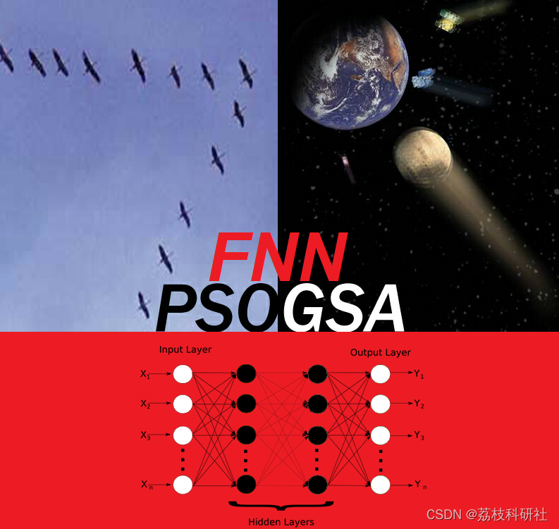
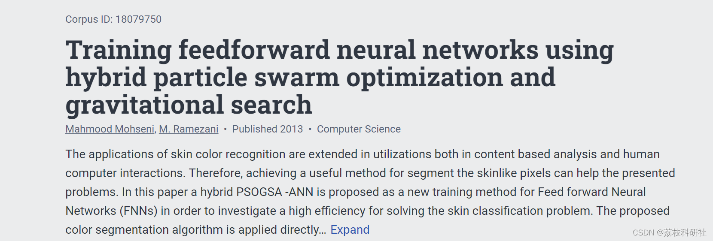
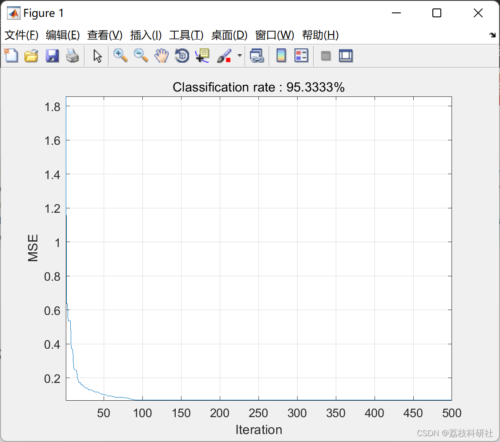
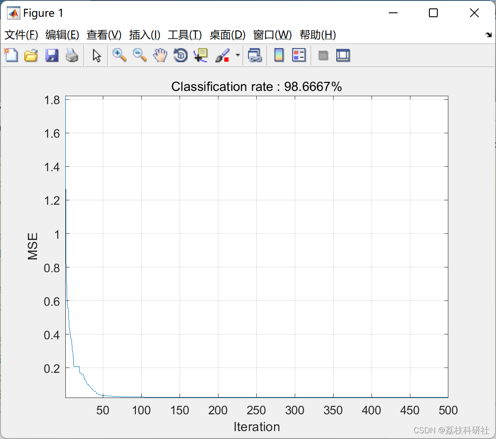

# Improved Feedforward Neural Network Based on Particle Swarm Optimization and Gravitational Search Hybrid Optimization Algorithm (Matlab Code Implementation)

​  
This paper utilizes a hybrid of Particle Swarm Optimization (PSO) and Gravitational Search Algorithm (GSA), referred to as PSOGSA, for training Feedforward Neural Networks (FNN). The algorithm is applied to the widely known Iris dataset. This program represents an improved feedforward neural network utilizing the hybrid algorithm known as PSOGSA.
Editor
The application of skin color recognition has been expanded in content-based analysis and human-computer interaction. Therefore, a useful method to segment skin pixels can help solve the presented issues. This paper proposes a new training method for PSOGSA-ANN as a feedforward neural network (FNNs) to study an efficient solution for skin classification problems. The proposed color segmentation algorithm is directly applied in the RGB color space without the need for color space conversion. Experimental results show that the proposed method can significantly improve the performance of the MLP algorithm in the task of skin color recognition.
📚2 Running Results Editing
Editor
Edit the code section:
x=sortrows(iris,2);  
H2=x(1:150,1);  
H3=x(1:150,2);  
H4=x(1:150,3);  
H5=x(1:150,4);  
T=x(1:150,5);  
H2=H2';  
[xf,PS] = mapminmax(H2);  
I2(:,1)=xf;  
H3=H3';  
[xf,PS2] = mapminmax(H3);  
I2(:,2)=xf;  
H4=H4';  
[xf,PS3] = mapminmax(H4);  
I2(:,3)=xf;  
H5=H5';  
[xf,PS4] = mapminmax(H5);  
I2(:,4)=xf;  
Thelp=T;  
T=T';  
[yf,PS5]= mapminmax(T);  
T=yf;  
T=T';  
%% /////////////////////////////////////////////FNN initial parameters//////////////////////////////////////  
HiddenNodes=15;   %Number of hidden codes  
Dim=8*HiddenNodes+3; %Dimension of masses in GSA  
TrainingNO=150;   %Number of training samples  
%% ////////////////////////////////////////////////////////GSA/////////////////////////////////////////////  
%Configurations and initializations  
noP = 30;      %Number of masses  
Max_iteration = 500; %Maximum number of iteration  
CurrentFitness =zeros(noP,1);  
G0=1; %Gravitational constant  
CurrentPosition = rand(noP,Dim); %Postition vector  
velocity = .3*randn(noP,Dim) ; %Velocity vector  
acceleration=zeros(noP,Dim); %Acceleration vector  
mass(noP)=0; %Mass vector  
force=zeros(noP,Dim);%Force vector  
%Vectores for saving the location and MSE of the best mass  
BestMSE=inf;  
BestMass=zeros(1,Dim);  
ConvergenceCurve=zeros(1,Max_iteration); %Convergence vector  
%Main loop  
Iteration = 0 ;  
while ( Iteration < Max_iteration )  
Iteration = Iteration + 1;  
G=G0*exp(-20*Iteration/Max_iteration);  
force=zeros(noP,Dim);  
mass(noP)=0;  
acceleration=zeros(noP,Dim);  
%Calculate MSEs  
for i = 1:noP  
for ww=1:(7*HiddenNodes)  
Weights(ww)=CurrentPosition(i,ww);  
end  
for bb=7*HiddenNodes+1:Dim  
Biases(bb-(7*HiddenNodes))=CurrentPosition(i,bb);  
end  
fitness=0;  
for pp=1:TrainingNO  
actualvalue=My_FNN(4,HiddenNodes,3,Weights,Biases,I2(pp,1),I2(pp,2), I2(pp,3),I2(pp,4));  
if(T(pp)==-1)  
fitness=fitness+(1-actualvalue(1))^2;  
fitness=fitness+(0-actualvalue(2))^2;  
fitness=fitness+(0-actualvalue(3))^2;  
end  
if(T(pp)==0)  
fitness=fitness+(0-actualvalue(1))^2;  
fitness=fitness+(1-actualvalue(2))^2;  
fitness=fitness+(0-actualvalue(3))^2;  
end  
if(T(pp)==1)  
fitness=fitness+(0-actualvalue(1))^2;  
fitness=fitness+(0-actualvalue(2))^2;  
fitness=fitness+(1-actualvalue(3))^2;  
end  
end  
fitness=fitness/TrainingNO;  
CurrentFitness(i) = fitness;  
end  
best=min(CurrentFitness);  
worst=max(CurrentFitness);  
🌈3 Matlab code implementation
🎉4 References
​  

## Images

<!-- PAYMENT_BLOCK -->

## Get this dataset

- Payment link (Stripe): [Buy now](https://buy.stripe.com/3cs8yP7sY87d0vu9AB)
- Payment QR code: 

<!-- /PAYMENT_BLOCK -->
